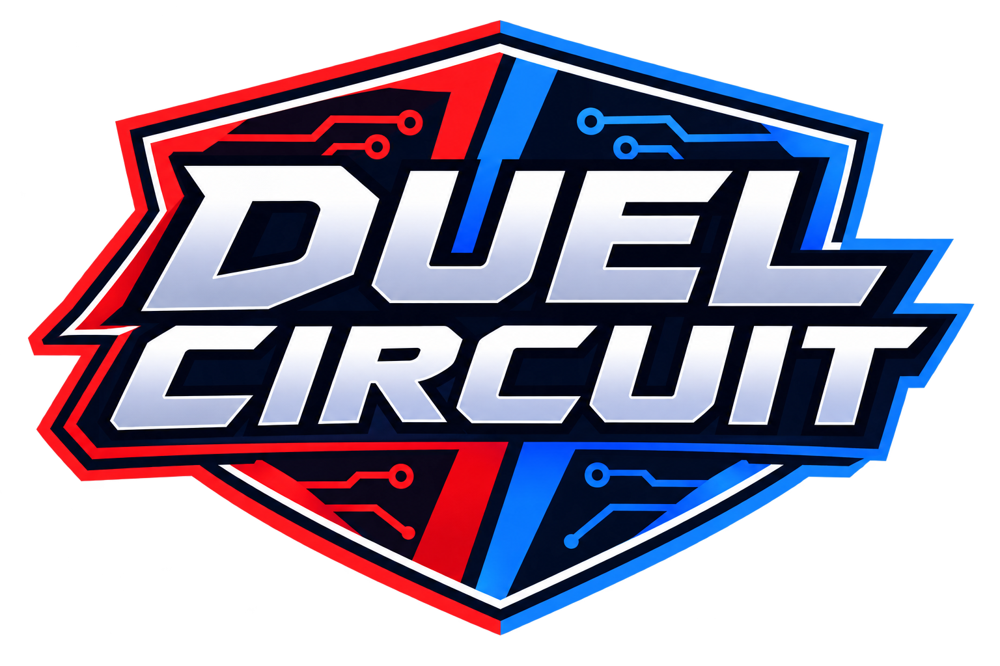
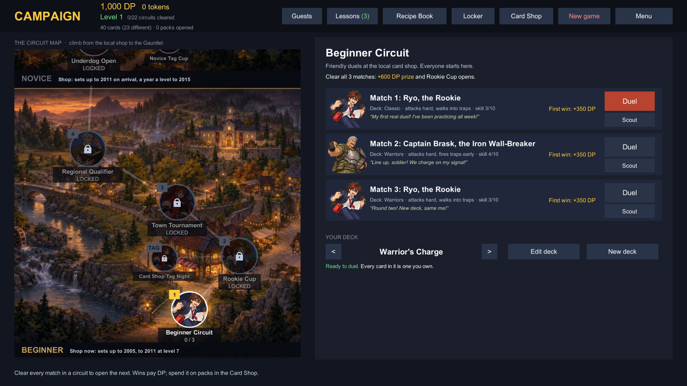
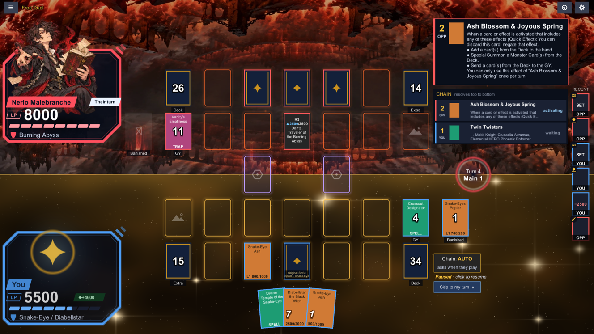
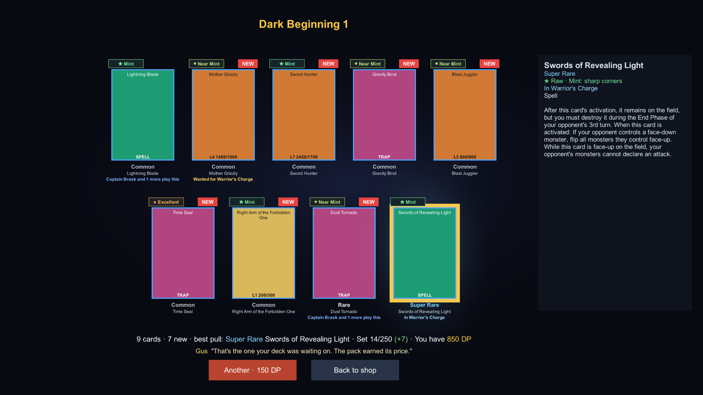
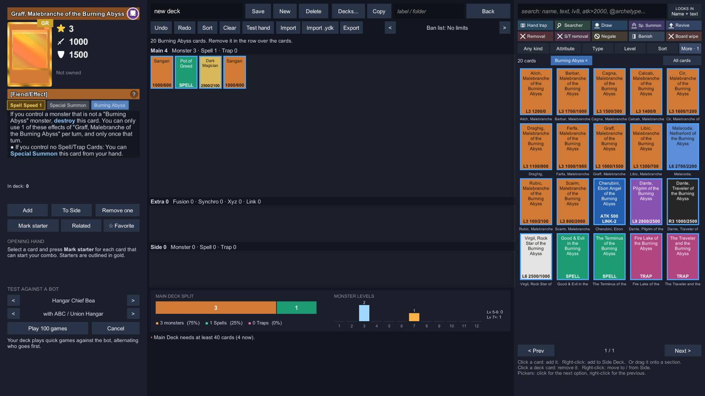

<p align="center">
  
</p>

<h1 align="center">Duel Circuit</h1>

<p align="center"><b>A solo Yu-Gi-Oh! campaign: from the corner card shop to the Tier 0 Gauntlet.</b></p>

<p align="center"><b><a href="https://github.com/fullstackjake/duel-circuit/releases">Download for Windows or Mac</a></b> · <a href="#install-and-play">How to install</a></p>

<p align="center">
  <a href="https://github.com/fullstackjake/duel-circuit/releases"></a>
  <a href="LICENSING.md"></a>
  
</p>

| | |
|---|---|
|  |  |
|  |  |

*Screenshots show cards without pictures. The game ships no card art; see [Card pictures](#card-pictures).*

## What is this?

Duel Circuit is a **free, fan-made, single-player** Yu-Gi-Oh! game for Windows and Mac. It works offline.

- Start at a small card shop with a starter deck.
- Climb **22 circuits** of CPU duelists (computer players) who play real tournament decks from **2004 to 2026**.
- Open packs, build decks and follow a story.
- Cards work as they do in EDOPro, because the game uses EDOPro's rules engine.

## Features

- **Campaign:** 22 circuits in 7 bands, over 180 story scenes, over 100 original duelists, 7 Tag Cups (2 against 2).
- **After the Gauntlet:** the Format Library (12 cups that replay famous formats, from Goat format to Ryzeal), the Back Alley (duels where you bet DP or a card), and the Champion's Ladder (10 steps to the top).
- **Duels:** click a card to act, tag duels, Free Duel, 41 historic ban lists, and replays you can share as a text code.
- **CPU duelists:** they read card text, only use what a real player could see, and plan ahead. 50 decks have their own playbook.
- **Deck building:** a card search, test games, EDOPro deck import, a Recipe Book of 82 decks, and 74 historic tournament decks (a different set).
- **Collecting:** packs from real TCG sets. Every copy has its own rarity (26 rarity finishes), a grade from 1 to 10, and wear.
- **Look and sound:** summon scenes, a big banner when an ace monster arrives, music made in code, controller support.

## System requirements

| | |
|---|---|
| **Windows** | Windows 10 or 11, 64-bit |
| **Mac** | macOS on Apple silicon (M1 or newer). Not Intel Macs yet. |
| **Linux** | Not supported yet |
| **Disk space** | About 220 MB, plus room for card pictures if you add them |
| **Internet** | Not needed |
| **Controller** | Optional |

## Install and play

### Windows

1. Go to the [Releases page](https://github.com/fullstackjake/duel-circuit/releases).
2. Under **Assets**, click the file that ends in `-win64.zip` (for example `DuelCircuit-0.2.0-win64.zip`) to download it.
3. Right-click the zip and choose **Extract All**, then click **Extract**. (Don't run the game from inside the zip.)
4. Open the new folder, then the `Duel Circuit` folder inside it.
5. Double-click **Duel Circuit** (`Duel Circuit.exe`).
6. A blue box may say **"Windows protected your PC"**. Click **More info**.
7. Click **Run anyway**. You only do this once.

Windows warns you because the game has no publisher signature (that costs money). It's safe to run.

### Mac (Apple silicon)

1. Go to the [Releases page](https://github.com/fullstackjake/duel-circuit/releases).
2. Under **Assets**, click the file that ends in `-mac.zip` to download it.
3. Double-click the zip to unzip it.
4. Open the `Duel Circuit` folder and move `Duel Circuit.app` to your **Applications** folder.
5. Open it. macOS will say it can't open the app (it has no publisher signature).
6. Open **System Settings → Privacy & Security**.
7. Scroll down to the message about Duel Circuit and click **Open Anyway**. You only do this once.

## Card pictures

The game ships with **no card pictures**: they belong to Konami. Until you add some, each card shows its name, stats
and text, and the game plays fine. If you have card pictures, choose **Import Cards** in the main menu to add them from
a zip or picture files. Other ways, and how to use EDOPro's pictures: [docs/CARD-PICTURES.md](docs/CARD-PICTURES.md).
Keep them to yourself: never share them.

## Your save

Your save, your decks and your card pictures live in a folder called `mods` (it's called `mods` because your own
add-ons go there too). Your Settings choices stay on each computer.

| | Your `mods` folder |
|---|---|
| **Windows** | `%USERPROFILE%\AppData\LocalLow\YgoCampaign\Duel Circuit\mods` |
| **Mac** | `~/Library/Application Support/YgoCampaign/YgoCampaign/mods` (yes, YgoCampaign twice) |

**To open it:**

- **Windows:** press **Windows key + R**, paste the path, and press **Enter**.
- **Mac:** in Finder, choose **Go → Go to Folder** (Shift+Cmd+G), paste the path, and press **Return**.

**To move your save to another computer:**

1. Close the game on both computers.
2. Copy the whole `mods` folder into the place shown in the table for the other computer.
3. Replace the `mods` folder that's there.

Saves are plain text files, so they should move between Windows and Mac. Tell us if one doesn't.

**If something goes wrong,** the game's log file (`Player.log`, a text file of what the game did) helps us. On
Windows it's here (Windows may show it as just **Player**):

```
%USERPROFILE%\AppData\LocalLow\YgoCampaign\Duel Circuit\Player.log
```

On a Mac, and how to send it: [CONTRIBUTING.md](CONTRIBUTING.md#the-playerlog-file).

## How to play

1. Choose **Campaign** in the main menu.
2. Pick a starter deck.
3. Pick a way to play. Choose **The shop's way** for your first run.
4. Gus offers a guided first duel. Click **Practice duel** if you're new to Yu-Gi-Oh! or to this game.
5. On the map, click a circuit. Its matches show on the right.
6. Click **Duel** next to the first match.
7. Every duel starts with a coin toss. If you win it, choose **Go first** or **Go second**.
8. Win duels to earn DP (Duel Points). Spend them in the **Card Shop**, make your deck stronger, and open the next circuit.

| Do this | Mouse and keyboard | Controller |
|---|---|---|
| Act with a card | Click it, then pick an action | Move the cursor, press **A** |
| Don't respond to a chain | Click **Don't chain** | **B** |
| See the whole field | Hold **Space** | Hold **RT** |
| Close a window or go back | **Esc** | **B** |

All the controls: [docs/PLAYING.md](docs/PLAYING.md#controls).

## Known issues

This is an early version (0.2.0).

**Platforms**
- These are the first public builds, and the Windows one hasn't been tried on many PCs yet. Tell us how it went:
  [open a bug report](https://github.com/fullstackjake/duel-circuit/issues/new/choose).
- Macs need Apple silicon. Intel Macs and Linux aren't supported.
- With no publisher signature, Windows and macOS warn you the first time (see [Install and play](#install-and-play)).
- A few small things work better on a Mac for now. On Windows, when the game window isn't in front, your first click
  only brings it to the front, and the window can be made very small.

**Things that affect your game**
- In the shop's way, the **Warrior's Charge** starter has 3 Reinforcement of the Army, but the Back Alley allows 1.
  Edit the deck before you go. (Historic Rules uses the deck's 2011 version, with 1 copy.)
- **No Limits** in the Back Alley is locked ("Coming soon").
- Difficulty isn't tuned yet. The early circuits are easy.
- Every duel uses today's game rules (Master Rule 5), even in historic formats.
- An older version of the game can lose parts of a newer save. Copy your `mods` folder first if you want to try one.
- We haven't measured how the game runs on slow computers yet.

Everything else: [the full list](docs/PLAYING.md#known-issues-full-list).

## FAQ

**Is this an official Yu-Gi-Oh! game?**
No. It's a free fan project (see the [Disclaimer](#disclaimer)).

**Do I need EDOPro?**
No. The game has its own copy of the rules engine.

**Can I play online?**
No. It's single-player and offline.

**Do my EDOPro decks work?**
Yes. Copy a YDKE link (the deck-sharing link EDOPro and deck sites make) or the text of a `.ydk` deck file (the
format EDOPro uses), then click **Import** in the deck editor. Or click **Import .ydk** and pick the file. Your decks are `.ydk` files in `mods/decks`, so EDOPro
can open them too.

**It's too hard, or too easy.**
Difficulty isn't tuned yet. Lose a match three times in a row and the game offers help: a scouting report, advice,
and decks you can borrow. Tell us where it felt wrong.

**Can I add my own duelists, decks or pictures?**
Yes. For pictures, choose **Import Cards** in the main menu ([docs/CARD-PICTURES.md](docs/CARD-PICTURES.md)). For
duelists and decks, see [docs/MODDING.md](docs/MODDING.md).

**I think a card works wrong.**
Please [report it](#everyones-welcome) with the replay code. If EDOPro gets it wrong too, it may need fixing there.

## Everyone's welcome

Duel Circuit is free: play it, copy it, share it, change it.

**Found a bug?** [Open a bug report](https://github.com/fullstackjake/duel-circuit/issues/new/choose) (a post on our
GitHub page; you need a free GitHub account). The form tells you what to include, and
[CONTRIBUTING.md](CONTRIBUTING.md#report-a-bug) shows how to find your replay code and log file. Please don't attach
card pictures.

**Have a question or want to help?** Read [CONTRIBUTING.md](CONTRIBUTING.md).

## Build from source

Building needs a Mac with Apple silicon, Unity 6 and a few free tools: see [docs/BUILDING.md](docs/BUILDING.md).
To change the game, start with [docs/DEVELOPING.md](docs/DEVELOPING.md). All guides: [docs/README.md](docs/README.md).

## Credits

- [Project Ignis](https://github.com/ProjectIgnis) (EDOPro): the rules engine ([ygopro-core](https://github.com/edo9300/ygopro-core)), card scripts, card database and ban lists.
- [YGOPRODeck](https://ygoprodeck.com/api-guide/): card-set data and six YCS Houston 2026 deck lists.
- [Format Library](https://www.formatlibrary.com): most historic decks and the historic ban lists.
- [yugiohmeta.com](https://www.yugiohmeta.com): 11 of the newest historic deck lists. All deck sources: [decks/history/SOURCES.md](decks/history/SOURCES.md).
- And the tools listed in [THIRD_PARTY_NOTICES.md](THIRD_PARTY_NOTICES.md).

Duelist portraits, duel mats and the map pictures: AI-generated art made for this project. Story backdrops, music and
sound effects are made in code. The logo is the project owner's own art.

Inspired by Tag Force, Master Duel, Link Evolution and Duel Links, but not connected to them.

## License

You can play, copy, share and change Duel Circuit for free. If you share a changed version, share its source too. The
code is under the [AGPL-3.0](LICENSE) (with a permission to build it with Unity). The art, story and characters are
under [CC BY-SA 4.0](LICENSES/CC-BY-SA-4.0.txt). The name and logo aren't covered, so give your version its own name.
Parts made by others keep their own licenses. Details: [LICENSING.md](LICENSING.md).

## Disclaimer

Konami and Shueisha did not make this game, and they don't approve or support it. Yu-Gi-Oh!, card names, card text
and card art belong to their owners. It's free, so please don't sell it. We don't take donations and there are no ads.
If you own the rights to something here and want it changed or removed,
[open an issue](https://github.com/fullstackjake/duel-circuit/issues) and we'll fix it quickly.
